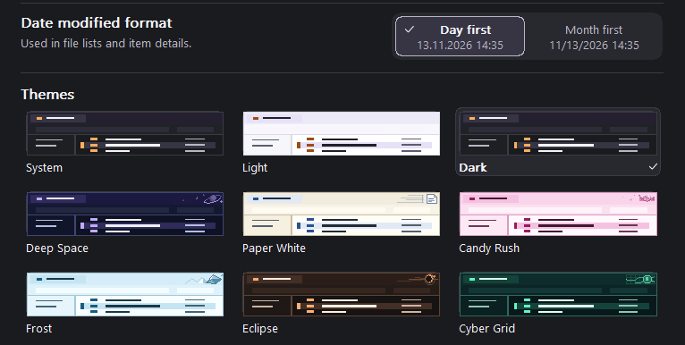

  

<h1 align="center">BetterExplorer</h1>

  <b>A native file manager for Windows 11.</b> 
  Tabs, Quick access, fast folder browsing, and an optional Win+E shortcut in a compact Rust app.

  <a href="https://github.com/TabanAziz/BetterExplorer/releases/latest"><b>Download</b></a> ·
  <a href="#what-you-get">Features</a> ·
  <a href="#the-numbers">Numbers</a> ·
  <a href="#install">Install</a> ·
  <a href="#build-from-source">Build</a>

Part of the Better series with [Better Task Manager](https://github.com/TabanAziz/BetterTaskManager) and [BetterClipboard](https://github.com/TabanAziz/BetterClipboard).

## Why BetterExplorer exists

Finding a file in Windows File Explorer can take a frustratingly long time, especially in a large folder or a location outside the Windows search index. BetterExplorer is my take on the file manager Microsoft should have shipped with Windows 11. It keeps familiar file browsing and puts responsiveness first, including when a search takes time.

BetterExplorer shows matches as they arrive and lets you stop a search whenever you need to. Home and This PC use the Windows index for filename searches. **Search all drives** can also reach readable folders outside that index and may take longer. The benchmarks below cover launch and folder browsing. Search timings and a head-to-head comparison with File Explorer are still pending.

## What you get

| Feature | How it works |
| --- | --- |
| **Navigation** | Tabbed windows, editable breadcrumbs, Quick access, Recent, Favorites, and built-in views for This PC, Network, Recycle Bin, and Libraries. |
| **File views** | Details, List, and four icon sizes. Date grouping puts files and folders in the same timeline. Windows file type icons load in the background. |
| **Search** | Search filenames under the active folder or use the Windows index from Home and This PC. **Search all drives** searches readable folders on local drives. |
| **File actions** | Copy, cut, paste, move, rename, create, and recycle. Cut items appear dimmed. Drag files onto folders or out to Windows drop targets. Ctrl+Z and Ctrl+Y work for supported operations in the current window. |
| **Archives and previews** | Compress or extract ZIP, 7z and TAR from the file menu. Use More options to choose the archive path, format and compression level. Preview images and text and access native Windows properties and Open with. |
| **Personalization** | Nine theme choices, two date formats, saved window size and position, and optional tab restoration. |

## The numbers

| BetterExplorer 0.1.7 | Median | p95 |
| --- | ---: | ---: |
| Warm launch to the first painted window | 104 ms | 124 ms |
| First entries in a 100,000-file folder | 56 ms | 69 ms |
| Complete sorted listing of that folder | 208 ms | 257 ms |

The executable is **1.79 MiB**. One 30-second idle sample recorded 0 ms of app CPU time at the timer's resolution. The benchmark used Windows 11 25H2, an Intel Core i7-11800H, and local NTFS with a warm cache. See the [method, p99 values, and raw data](docs/benchmarks.md).

## Install

BetterExplorer is a preview for **Windows 11 x64**. Download the Setup EXE or portable ZIP from the [latest release](https://github.com/TabanAziz/BetterExplorer/releases/latest). The release includes SHA-256 checksums. The executables are unsigned.

- **Setup EXE** installs BetterExplorer for your Windows account. Choose whether to use Win+E and folder integration, and whether to create a Start menu shortcut. Run the new Setup EXE to update. To uninstall, open **Settings > Apps > Installed apps** and select BetterExplorer.
- **Portable ZIP** can be extracted to a folder of your choice. Open `BetterExplorer.exe` to start.

Open **Settings** or press **Ctrl+,** to choose what **Win+E** opens. Selecting BetterExplorer starts a small helper for your Windows session and registers a per-user Windows sign-in task. The Startup Apps entry also works as a fallback. Win+E brings an open, responsive BetterExplorer window from the same installation forward when possible. Use Ctrl+N to open a separate window. When updating a portable copy, select **BetterExplorer** again to register the task. Choose **File Explorer** in Settings before moving or removing a portable copy that manages the shortcut.

**Default folder manager** is a separate option in Setup and Settings. Enable it to open folders and drives in BetterExplorer when apps use the Windows shell's default folder command. Folders opened inside File Explorer follow its folder options. Apps that launch `explorer.exe` directly continue to open File Explorer. Choose **Windows default** to restore the previous folder handler before moving or removing a portable copy. When updating a portable copy from 0.1.8 in place, select **Windows default** and then **BetterExplorer** again to update an existing registration.

Use `BetterExplorer.exe --select "C:\path\to\file.txt"` to open the containing folder and select a file or subfolder.

## Keys

| Key | Action |
| --- | --- |
| Ctrl+T / Ctrl+W | Open / close a tab |
| Ctrl+L | Edit the address bar |
| Ctrl+F | Search |
| F2 | Rename |
| Ctrl+Z / Ctrl+Y | Undo / redo a supported file operation |
| Ctrl+, | Open Settings |

## Known limitations

This preview covers everyday file browsing and operations. Gallery, file-specific thumbnails, third-party context-menu extensions, cloud overlays, and advanced search syntax are pending. Undo works for supported operations in the current window and covers moves on the same volume. The full [limitations](docs/limitations.md) and [feature matrix](docs/parity-matrix.csv) provide details.

## Build from source

Use Rust stable, the x64 MSVC tools, and the Windows SDK.

    cargo build --release --locked
    cargo test --locked
    powershell -NoProfile -File tools\release.ps1

Cargo writes the executable to `target\release\BetterExplorer.exe`. Install Inno Setup 6.6 or later to package the Setup EXE. The packaging command writes Setup, the portable ZIP and their checksums under `dist\`. Use `-PortableOnly` to package just the ZIP.

- [Contributing](CONTRIBUTING.md)
- [Architecture](docs/architecture.md)
- [Test plan](docs/test-plan.md)
- [Benchmarks](docs/benchmarks.md)

## License

[MIT](LICENSE). Dependency notices are in [THIRD-PARTY-LICENSES](THIRD-PARTY-LICENSES).
