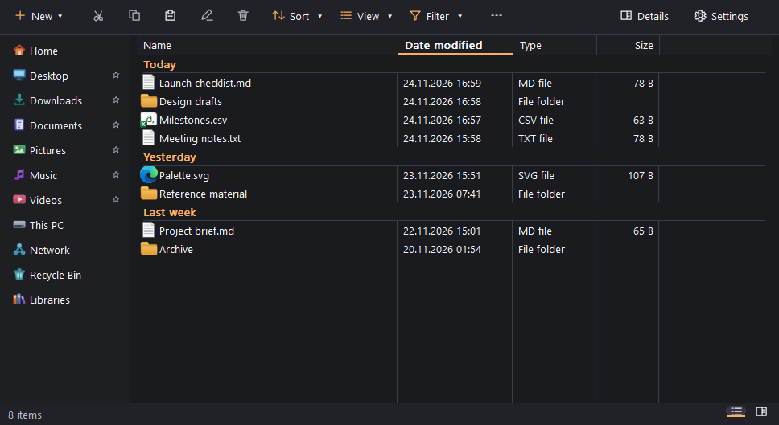

  

<h1 align="center">BetterExplorer</h1>

  <b>A native file manager for Windows 11.</b> 
  Tabs, Quick access, fast folder browsing, and an optional Win+E shortcut in a compact Rust app.

  <a href="https://github.com/TabanAziz/BetterExplorer/releases/latest"><b>Download</b></a> ·
  <a href="#what-you-get">Features</a> ·
  <a href="#the-numbers">Numbers</a> ·
  <a href="#install">Install</a> ·
  <a href="#build-from-source">Build</a>

Part of the Better series with [Better Task Manager](https://github.com/TabanAziz/BetterTaskManager) and [BetterClipboard](https://github.com/TabanAziz/BetterClipboard).

## What you get

| Feature | How it works |
| --- | --- |
| **Navigation** | Tabbed windows, editable breadcrumbs, Quick access, Recent, Favorites, and built-in views for This PC, Network, Recycle Bin, and Libraries. |
| **File views** | Details, List, and four icon sizes. Date grouping puts files and folders in the same timeline. Windows file type icons load in the background. |
| **Search** | Search filenames under the active folder or use the Windows index from Home and This PC. **Search all drives** searches readable folders on local drives. |
| **File actions** | Copy, cut, paste, move, rename, create, and recycle. Drag files out to Windows drop targets, and use Ctrl+Z or Ctrl+Y for supported operations in the current window. |
| **ZIP and previews** | Create and extract ZIP files, view image and text previews, and use native Windows properties and Open with. |
| **Personalization** | Nine theme choices, two date formats, saved window size and position, and optional tab restoration. |

## The numbers

| BetterExplorer 0.1.7 | Median | p95 |
| --- | ---: | ---: |
| Warm launch to the first painted window | 104 ms | 124 ms |
| First entries in a 100,000-file folder | 56 ms | 69 ms |
| Complete sorted listing of that folder | 208 ms | 257 ms |

The executable is **1.79 MiB**. One 30-second idle sample recorded 0 ms of app CPU time at the timer's resolution. The benchmark used Windows 11 25H2, an Intel Core i7-11800H, and local NTFS with a warm cache. See the [method, p99 values, and raw data](docs/benchmarks.md).

## Install

BetterExplorer is a preview for **Windows 11 x64**. Download the portable ZIP from the [latest release](https://github.com/TabanAziz/BetterExplorer/releases/latest), extract it, and run `BetterExplorer.exe`. The release includes SHA-256 checksums. The executable is unsigned.

Open **Settings** or press **Ctrl+,** to choose what **Win+E** opens. Selecting BetterExplorer starts a small helper for your Windows session and configures it to run at sign-in. Choose **File Explorer** in Settings before moving or removing a portable copy that manages the shortcut.

## Keys

| Key | Action |
| --- | --- |
| Ctrl+T / Ctrl+W | Open / close a tab |
| Ctrl+L | Edit the address bar |
| Ctrl+F | Search |
| F2 | Rename |
| Ctrl+Z / Ctrl+Y | Undo / redo a supported file operation |
| Ctrl+, | Open Settings |

## Known limitations

This preview covers everyday file browsing and operations. Gallery, file-specific thumbnails, third-party context-menu extensions, cloud overlays, and advanced search syntax are pending. Undo works for supported operations in the current window and covers moves on the same volume. The full [limitations](docs/limitations.md) and [feature matrix](docs/parity-matrix.csv) provide details.

## Build from source

Use Rust stable, the x64 MSVC tools, and the Windows SDK.

    cargo build --release --locked
    cargo test --locked
    powershell -NoProfile -File tools\release.ps1 -PortableOnly

Cargo writes the executable to `target\release\BetterExplorer.exe`. The packaging command writes the portable ZIP and checksums under `dist\`.

- [Contributing](CONTRIBUTING.md)
- [Architecture](docs/architecture.md)
- [Test plan](docs/test-plan.md)
- [Benchmarks](docs/benchmarks.md)

## License

[MIT](LICENSE). Dependency notices are in [THIRD-PARTY-LICENSES](THIRD-PARTY-LICENSES).
